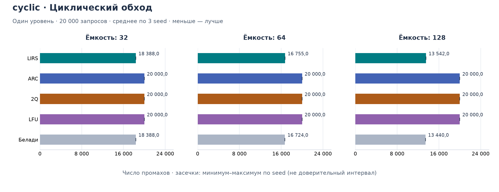
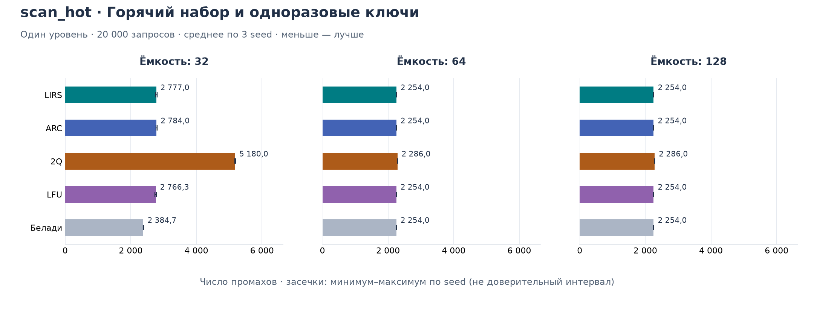
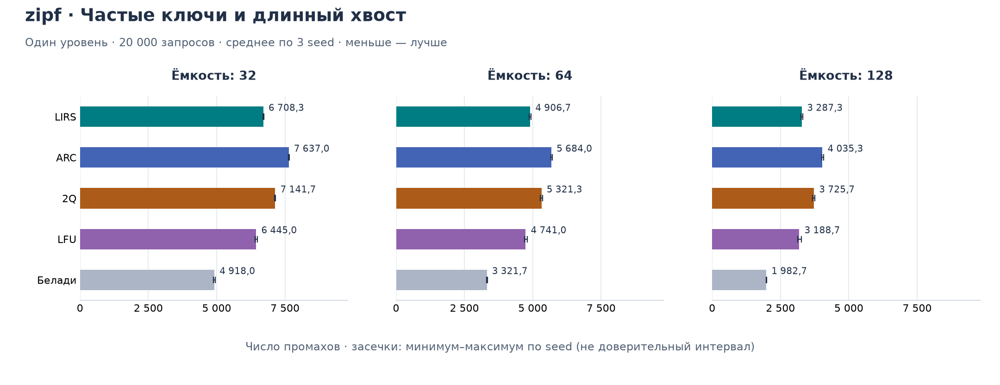
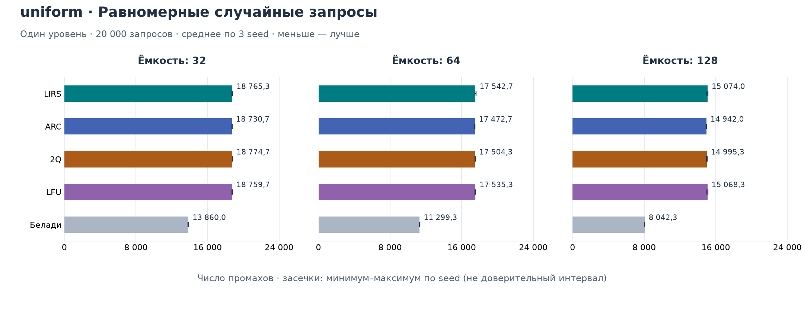
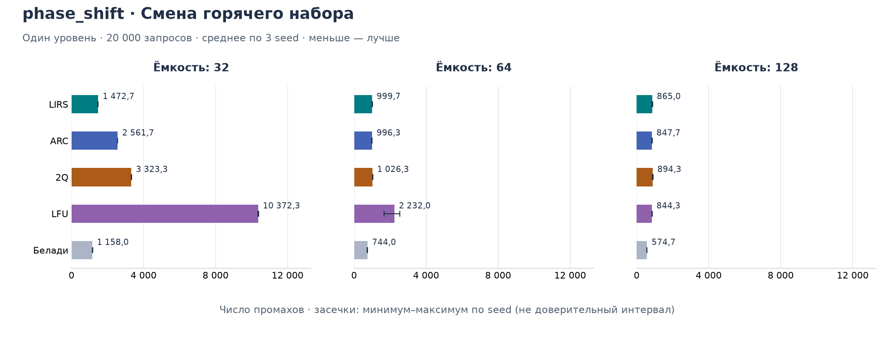
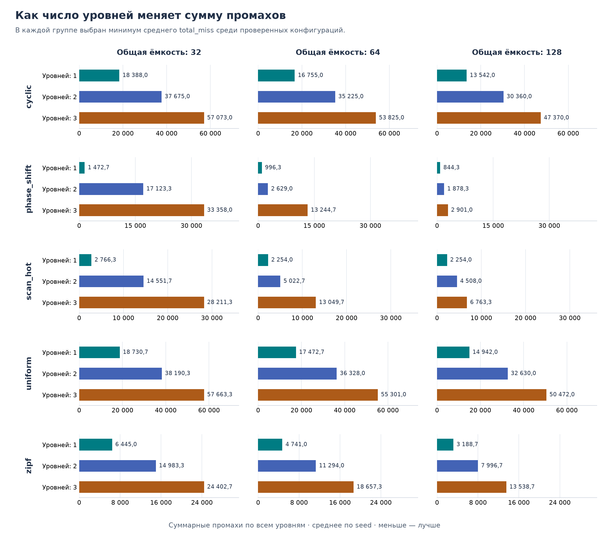

# MIPT_Cache

Симулятор многоуровневого кэша на C++17 для исследования и сравнения алгоритмов вытеснения: **2Q, ARC, LFU, LIRS**. Позволяет строить иерархию произвольной глубины и измерять суммарное количество промахов на последовательности запросов.

## Архитектура

- **Структуры данных**: алгоритмы используют `std::unordered_map` и `std::list` с прямым хранением итераторов; сложность обращения — O(1).
- **Иерархия (`CacheAPI`)**: паттерн «Цепочка обязанностей». При промахе на текущем уровне запрос автоматически перенаправляется ниже через лямбду `fetch_from_next`.
- **Оптимальный кэш (Белади)**: алгоритм `SimulatePerfectCache`, использующий знание будущих запросов для оценки минимально возможного числа промахов — `O(N log C)`.

## Сборка и запуск

Требования: компилятор с поддержкой C++17, CMake 3.25 или новее, Python 3, Git и инструмент сборки для выбранного генератора CMake (например, GNU Make или Ninja).

GoogleTest скачивается автоматически через FetchContent при конфигурации проекта, поэтому нужен доступ к GitHub.

Все команды выполняются из корня проекта.

### Сборка

```bash
cmake -S . -B build -DCMAKE_BUILD_TYPE=Release
cmake --build build --parallel
```

### Тестирование

Запуск всех тестов — unit, e2e и проверки запуска с конфигурацией:

```bash
ctest --test-dir build --output-on-failure
```

Отдельный запуск e2e-тестов:

```bash
python3 tests/e2e/test_program.py --binary ./build/modules/cache_exec
```

## Запуск

Программа принимает файл конфигурации первым аргументом, а трассу читает из стандартного ввода (`stdin`):

```bash
./build/modules/cache_exec config.cfg < trace.txt
```

### Формат конфигурации (`config.cfg`)

Первая строка — количество уровней. Далее для каждого уровня (от L1 к нижним) указывается его ёмкость и алгоритм (`2Q`, `ARC`, `LFU`, `LIRS`):

```text
3
5 LFU
9 LFU
18 LIRS
```

### Формат трассы (`trace.txt`)

Первое число — количество запросов, затем перечень ключей:

```text
8
1 2 1 3 1 2 4 1
```

### Вывод программы

```text
Misses: 12
Perfect cache misses: 9
```

## Алгоритмы

- **LFU** — выкидывает элемент с минимальной частотой обращений. 
- **2Q** — три очереди: входной буфер `IN` (FIFO), основной кэш `HOT` (LRU) и история вытесненных ключей `OUT` (хранит только ключи без данных). 
- **ARC** — держит два списка реальных элементов (`T1` для недавних, `T2` для частых) и два призрачных списка истории (`B1`, `B2`). Сам двигает границу между `T1` и `T2` в зависимости от того, в какую из историй попадают запросы.
- **LIRS** — разделяет ключи на LIR (горячие, с маленьким расстоянием между повторными обращениями) и HIR (холодные). Использует стек `S` и очередь резидентных HIR-блоков `Q`; подрезает хвост стека (`prune`), чтобы на дне всегда лежал LIR-блок.

## Бенчмарки и скрипты (`research/`)

Исходные измерения хранятся в [`research/results/results.csv`](research/results/results.csv), конфигурации — в [`configs/`](research/results/configs/), входные последовательности — в [`traces/`](research/results/traces/). Графики ниже построены по этому архиву.

### Параметры и качество данных

| Параметр | Значение в опубликованном эксперименте |
|---|---|
| Запросов в каждой трассе | 20 000, с учётом начального заполнения кэша |
| Базовое пространство ключей | 512; фактические наборы зависят от нагрузки |
| Seed | 1, 2, 3; одни и те же трассы для всех конфигураций |
| Алгоритмы | LIRS, ARC, 2Q, LFU; все упорядоченные сочетания между уровнями |
| Число уровней | 1, 2, 3 |
| Сумма заданных ёмкостей | 32, 64, 128 элементов |
| Разбиения памяти | 1 вариант для одного уровня, 3 для двух, 4 для трёх |
| Конфигурации | 924: 12 одноуровневых, 144 двухуровневых, 768 трёхуровневых |
| Измерения в сводках | 924 конфигурации × 5 нагрузок × 3 seed = **13 860** |


### Какие нагрузки используются

| Нагрузка | Фактический профиль при `keyspace=512` | 
|---|---|
| `uniform` | Независимые равномерные запросы к 512 ключам |
| `zipf` | Вес ключа ранга r пропорционален `1 / r^1.15` | 
| `cyclic` | Повторяющийся цикл по 384 ключам | 
| `scan_hot` | 8 случайных обращений к 32 горячим ключам, затем один новый одноразовый ключ | 
| `phase_shift` | Смена горячего набора `0…31` на `32…63` после 10 000 запросов; на каждом шаге 5% вероятности равномерного запроса к 512 ключам | 
В `cyclic` рабочий набор существенно больше всех проверяемых одноуровневых ёмкостей. Эта нагрузка не использует генератор случайных чисел: три seed дают **одну и ту же трассу**, поэтому разброс результатов равен нулю.

### Воспроизведение анализа и графиков

Команды выполняются из корня проекта. Для анализа нужен Python 3, для графиков дополнительно нужен Matplotlib:

```bash
python3 -m venv /tmp/mipt-cache-plots
/tmp/mipt-cache-plots/bin/python -m pip install matplotlib
python3 research/analyze_results.py research/results/results.csv
/tmp/mipt-cache-plots/bin/python research/plot_results.py \
  research/results/summary_by_workload.csv \
  research/results/summary_by_algorithm.csv
```

Скрипт создаёт четыре таблицы:

- [`summary_by_workload.csv`](research/results/summary_by_workload.csv) — 4 620 строк: среднее, минимум и максимум промахов по трём seed для каждой нагрузки и конфигурации;
- [`summary_best_by_budget.csv`](research/results/summary_best_by_budget.csv) — конфигурации с минимальным средним `total_miss` для каждой нагрузки, общей ёмкости и числа уровней; все равные минимумы сохраняются;
- [`summary_overall.csv`](research/results/summary_overall.csv) — средние по пяти нагрузкам для каждой конфигурации;
- [`summary_by_algorithm.csv`](research/results/summary_by_algorithm.csv) — средние результаты всех конфигураций, в которых используется каждый алгоритм.

`plot_results.py` записывает графики `single_*.png` и `hierarchy_best.png` в [`research/plots/`](research/plots/). Флаг `--rankings` дополнительно перестраивает прежние топ-5 по `gap%`; `--top` меняет размер этих топов, `--output-dir` — каталог изображений.

Для **нового полного эксперимента** используйте отдельный каталог:

```bash
cmake -S . -B build -DCMAKE_BUILD_TYPE=Release
cmake --build build --parallel
python3 research/run_experiments.py \
  --binary ./build/modules/cache_exec --output-dir research/new_results
python3 research/analyze_results.py research/new_results/results.csv
/tmp/mipt-cache-plots/bin/python research/plot_results.py \
  research/new_results/summary_by_workload.csv \
  research/new_results/summary_by_algorithm.csv \
  --output-dir research/new_plots
```

Сгенерировать отдельную трассу:

```bash
python3 research/generate_workloads.py \
  --workload zipf --requests 20000 --keyspace 512 --seed 1 \
  --output /tmp/trace.txt
```

Основные флаги `run_experiments.py`:

| Параметр | По умолчанию | Назначение |
|---|---|---|
| `--algorithms` | `LIRS,ARC,2Q,LFU` | Доступные алгоритмы |
| `--algo-mode` | `all` | Все упорядоченные сочетания; также есть `uniform` и `mixed` |
| `--levels` | `1,2,3` | Число уровней |
| `--total-capacities` | `32,64,128` | Сумма ёмкостей уровней |
| `--workloads` | Все пять нагрузок | Профили запросов |
| `--requests`, `--keyspace` | `20000`, `512` | Длина трассы и базовое пространство ключей |
| `--seeds` | `1,2,3` | Начальные значения генератора |
| `--output-dir` | `research/results` | Каталог CSV, трасс и конфигураций |
| `--max-runs` | `0` | Ограничение числа запусков; `0` — без ограничения |
| `--timeout` | `30` | Тайм-аут одного запуска, секунд |

Повторный запуск пропускает уже успешные `case_id`. Для быстрой проверки можно добавить `--max-runs 20` и указать отдельный каталог, например `--output-dir research/smoke`.

## Как читать результаты

`total_miss` — **сумма промахов на всех уровнях**. Запрос, промахнувшийся в трёх уровнях, добавляет 3. 

`perfect_miss` вычисляется `RunPerfectCache`: Белади применяется к исходной трассе на первом уровне, затем к его потоку промахов на втором и так далее. 

```text
gap = avg_total_miss - avg_perfect_miss
gap% = 100 * gap / avg_perfect_miss
```

**`gap% = 0` означает совпадение числа промахов с эталоном.**

Основные изображения сравнивают все четыре алгоритма **на одном уровне при одинаковых ёмкостях**. Цвет обозначает алгоритм, серый столбец — Белади; горизонтальная шкала одинакова в трёх панелях одной нагрузки и начинается с нуля. На графике показано среднее значение промахов по трём seed. Засечки обозначают минимум и максимум, при совпадении результатов они сливаются.

### Циклический обход (`cyclic`):



| Ёмкость | LIRS: промахи | Белади: промахи | gap% LIRS | Доля промахов LIRS |
|---:|---:|---:|---:|---:|
| 32 | 18 388 | 18 388 | 0,000% | 91,94% |
| 64 | 16 755 | 16 724 | 0,185% | 83,78% |
| 128 | 13 542 | 13 440 | 0,759% | 67,71% |

При ёмкости 32 реализация LIRS удерживает 31 LIR-блок и использует один HIR-слот для остальных ключей. На этой трассе защищённые LIR-блоки сохраняются между обходами. Всего получаются 1 612 попаданий и 18 388 промахов — ровно столько же промахов даёт Белади. Все ключи цикла имеют одинаковую частоту.

### Горячий набор со сканированием (`scan_hot`):


Все 32 горячих ключа встречаются в каждой сохранённой трассе. Каждый из 2 222 сканирующих ключей встречается один раз. Поэтому неизбежно не менее:

```text
32 первых загрузки горячих ключей + floor(20000 / 9) = 2254 промаха
```

LIRS, ARC и LFU при ёмкостях **64 и 128** достигают ровно 2 254 промахов — по одному на каждый различный ключ. Отсюда шесть равных результатов с `gap = 0`. Доля промахов при этом составляет **11,27%**.

При ёмкости 32 места для всех горячих ключей и загружаемого сканирующего блока уже не хватает. 

2Q при 64 и 128 даёт 2 286 промахов — всего на 32 больше минимума. Это согласуется с его правилом продвижения: попадания в FIFO-очередь IN не переводят блок в HOT; продвижение происходит при запросе уже вытесненного ключа из OUT.


### Частотная нагрузка (`zipf`)



На одном уровне LFU имеет наименьшее среднее число промахов при всех трёх ёмкостях: **6 445,0 → 4 741,0 → 3 188,7**. Следом идёт LIRS: **6 708,3 → 4 906,7 → 3 287,3**. 

Прежний рейтинг по `gap%` ставил первой цепочку `LFU → LFU → LIRS` с размерами `5 → 9 → 18`: 16,134% отклонения. Однако при той же ёмкости 32 она даёт 28 124,7 суммарных промахов против 6 445,0 у одноуровневого LFU. Меньшее отклонение от своего эталона не делает эту цепочку лучшим выбором по сумме промахов.

### Равномерные запросы (`uniform`)



У всех алгоритмов близкие результаты. При ёмкости 32 средние лежат между **18 730,7 и 18 774,7**, при 64 — между **17 472,7 и 17 542,7**, при 128 — между **14 942,0 и 15 074,0**. Наименьшее среднее во всех трёх случаях у ARC, но трёх seed недостаточно для общего вывода о его преимуществе.


### Смена горячего набора (`phase_shift`)



При ёмкости 32 преимущество LIRS велико: **1 472,7** промаха против 2 561,7 у ARC, 3 323,3 у 2Q и **10 372,3** у LFU.

При ёмкости 64 LIRS и ARC уже близки: **999,7 и 996,3**. LFU даёт 2 232,0, причём диапазон по seed широк: **1 667–2 545**.

При ёмкости 128 LFU имеет минимальное среднее **844,3**, далее ARC — 847,7 и LIRS — 865,0. Диапазоны по seed у них пересекаются: 837–857, 838–859 и 848–882 соответственно. 
### Иерархия при фиксированной ёмкости



Для каждой нагрузки, ёмкости и числа уровней выбран минимум **среднего `total_miss`** среди всех проверенных алгоритмов и разбиений памяти. Конфигурации победителей и все равные минимумы перечислены в [`summary_best_by_budget.csv`](research/results/summary_best_by_budget.csv).

При ёмкости 32:

| Нагрузка | Лучший один уровень | Лучшие два уровня | Лучшие три уровня |
|---|---|---|---|
| `cyclic` | LIRS, 32: **18 388,0** | LIRS → LIRS, 16 → 16: 37 675,0 | LIRS → LIRS → LIRS, 10 → 11 → 11: 57 073,0 |
| `zipf` | LFU, 32: **6 445,0** | LFU → LIRS, 16 → 16: 14 983,3 | LFU → LFU → LFU, 10 → 11 → 11: 24 402,7 |
| `uniform` | ARC, 32: **18 730,7** | LFU → 2Q, 16 → 16: 38 190,3 | LFU → LFU → LIRS, 10 → 11 → 11: 57 663,3 |
| `scan_hot` | LFU, 32: **2 766,3** | LFU → LIRS, 16 → 16: 14 551,7 | LFU → LFU → LIRS, 10 → 11 → 11: 28 211,3 |
| `phase_shift` | LIRS, 32: **1 472,7** | LIRS → 2Q, 16 → 16: 17 123,3 | LIRS → ARC → LIRS, 10 → 11 → 11: 33 358,0 |


### Топ по алгоритмам

После обработки повторных попыток в каждую группу входит 7 650 успешных случаев:

| Алгоритм, встречающийся в конфигурации | Средний total_miss | Средний perfect_miss | Агрегированный gap% |
|---|---:|---:|---:|
| LIRS | 34 407,517 | 25 859,343 | 33,056% |
| LFU | 34 726,113 | 25 859,343 | 34,288% |
| ARC | 35 045,933 | 25 859,343 | 35,525% |
| 2Q | 35 047,123 | 25 859,343 | 35,530% |

Группы пересекаются: цепочка `LIRS → ARC → LFU` входит сразу в три группы. Внутри смешаны ёмкости, число уровней и нагрузки; процент вычисляется как отношение сумм, а не среднее процентов. Поэтому первое место LIRS не устанавливает универсального победителя среди отдельных алгоритмов.

